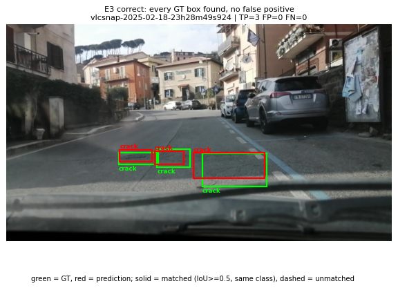
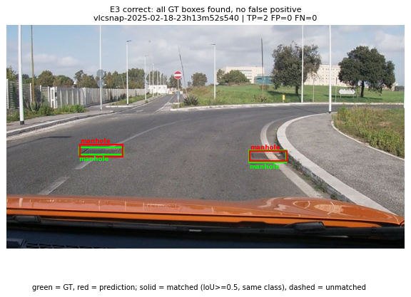
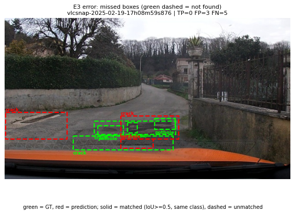
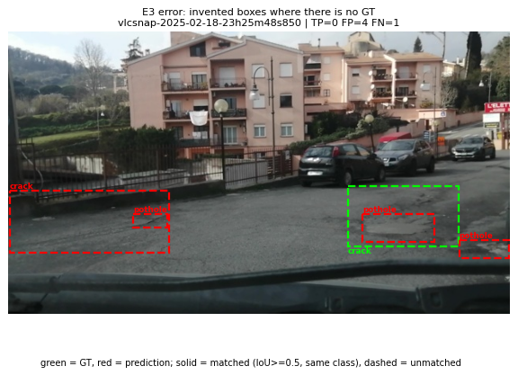
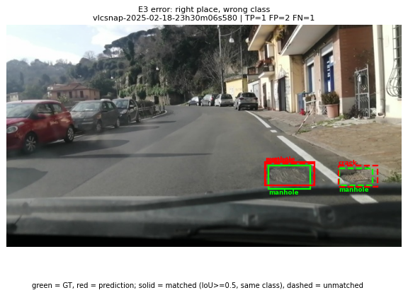
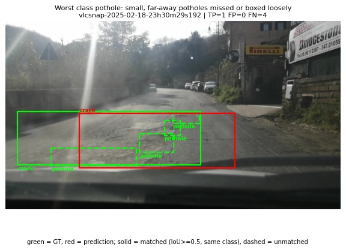
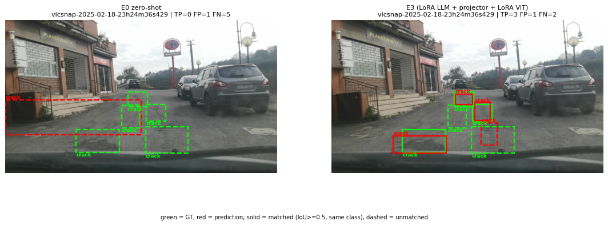
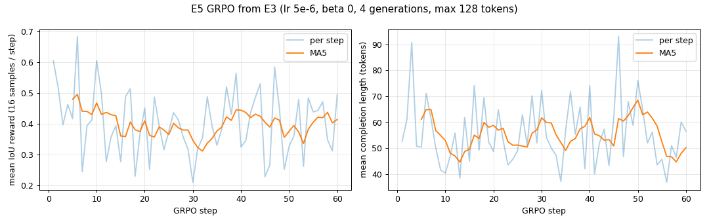

Họ tên: Văn Quốc Dũng - 2A202602505  
`dataset_version`: d10-21e4070301

## Bảng tổng hợp (số của bạn, lấy từ `report/evidence/*.json`)

| Mã | Setup | Tham số huấn luyện | VRAM đỉnh (GB) | Phút | F1 | CI95 | FP/ảnh | F1 pothole | F1 crack | F1 manhole |
|---|---|---|---|---|---|---|---|---|---|---|
| E0 | zero-shot | 0 | 3.94 (suy luận, L4) | 7.1 (suy luận) | 0.103 | 0.077–0.134 | 0.96 | 0.164 | 0.030 | 0.235 |
| E1 | LoRA LLM | 33,030,144 | 6.98 | 20.8 | 0.264 | 0.227–0.304 | 1.30 | 0.160 | 0.195 | 0.532 |
| E2 | + projector | 142,135,296 | 8.8 | 21.3 | 0.339 | 0.301–0.380 | 1.07 | 0.202 | 0.268 | 0.606 |
| E3 | + LoRA ViT | 148,426,752 | 8.99 | 25.6 | 0.432 | 0.390–0.473 | 0.90 | 0.310 | 0.365 | 0.671 |
| E4 | coord_scale = norm1000 (= E3, cùng predictions) | 148,426,752 | 8.99 | 25.6 | 0.432 | 0.390–0.473 | 0.90 | 0.310 | 0.365 | 0.671 |
| E4 | coord_scale = pixel (setup E3) | 148,426,752 | 9.05 | 26.6 | 0.398 | 0.359–0.435 | 1.09 | 0.291 | 0.299 | 0.689 |
| E5 | GRPO từ E3 (bonus) | 39,321,600 | 8.04 | 31.1 | 0.438 | 0.394–0.481 | 0.79 | 0.287 | 0.383 | 0.662 |

E1–E4 huấn luyện trên Colab L4, fp16, 300 bước (batch 2 × grad_accum 4, seed 42). Phút suy luận test (311 ảnh, batch 4): E1 16.7 · E2 13.3 · E3 13.8 · E4-pixel 16.3 · E5 12.8. E5 = 60 bước GRPO (không phải 300 bước SFT).

## 10 câu hỏi (trả lời bằng **số của bạn**, không chép lại tài liệu)

### Câu 1 — Kiến trúc: ViT, projector và LLM của Qwen3-VL-4B có bao nhiêu tham số mỗi khối, và E1/E2/E3 mỗi cái cập nhật khối nào?
Đếm trên model thật (`named_parameters`, trọng số 4-bit đếm lại về số phần tử gốc), tổng **4 437,8M**:

| Khối | Tham số | Dạng lưu khi train |
|---|---|---|
| ViT (`model.visual`, 24 block, không kể projector) | 306,2M | fp16, không lượng tử hoá |
| Projector `visual.merger` | 27,3M | fp16 (E2/E3: fp32) |
| Projector `visual.deepstack_merger_list` (3 merger, lấy đặc trưng ViT lớp 5/11/17) | 81,8M | fp16 (E2/E3: fp32) |
| LLM (`language_model` 36 lớp + embedding, `lm_head` dùng chung embedding) | 4 022,5M | NF4 4-bit (đóng băng) |

- **E1**: chỉ LoRA r=16 trên 252 lớp tuyến tính của LLM (36 lớp × q,k,v,o,gate,up,down) → **33,0M** tham số huấn luyện; ViT và projector đóng băng.
- **E2**: E1 + mở **toàn bộ** projector (merger + deepstack, 109,1M, fp32) → **142,1M**.
- **E3**: E2 + LoRA trên 96 lớp của ViT (24 block × qkv, proj, linear_fc1, linear_fc2), tổng 348 module LoRA → **148,4M** (ViT LoRA chỉ thêm 6,3M).
Trọng số gốc của LLM và ViT không bao giờ được cập nhật; chỉ adapter LoRA (và projector ở E2/E3) học.

### Câu 2 — E0: `parse_valid_rate` bằng bao nhiêu, và hai lỗi phổ biến nhất của model gốc là gì (kèm một ví dụ output thô)?
`parse_valid_rate` = **0,971** (302/311). Model gốc **không** bọc ```` ```json ```` (0/311), không thêm chữ, và dùng đúng thang 0–1000 (trung vị toạ độ lớn nhất của box = 750; 0% box nằm gọn trong 640×360; chấm lại theo pixel cho F1 = 0). Vậy lỗi chính không phải định dạng mà là **nội dung**:

1. **Bỏ sót**: chỉ dự đoán 346 box cho 583 box thật, 11 ảnh trả `[]`; 400/535 FN là box không có dự đoán cùng lớp nào chạm tới (IoU < 0,1) → recall 0,082.
2. **Bịa box / box sai chỗ**: 298 FP, trong đó 171 không chạm box thật cùng lớp nào (IoU < 0,1) và 119 có chạm nhưng IoU < 0,5. Lớp crack tệ nhất: đoán crack 241 lần nhưng chỉ 8 lần đúng (F1 0,030).

JSON hỏng chỉ 9 ảnh (2,9%) và sai lớp chỉ 8 FP. Cả 9 output hỏng đều là **lặp vô hạn** bị cắt ở 256 token, ví dụ `vlcsnap-2025-02-18-23h15m37s152`:
```
[{"label": "crack", "bbox_2d": [575, 420, 600, 440]}, {"label": "crack", "bbox_2d": [575, 440, 600, 460]}, {"label": "crack", "bbox_2d": [575, 460, 600, 480]}, ... (cắt ở 256 token, không có "]")
```
Một output hợp lệ điển hình: `vlcsnap-00200 → [{"label": "crack", "bbox_2d": [750, 634, 850, 684]}]` (một box, trượt so với nhãn).

### Câu 3 — Thang 0–1000: nếu chấm output theo pixel (hoặc ngược lại) thì F1 ra sao và vì sao? Bạn đã kiểm chứng điều này thế nào?
Chấm sai thang cho **F1 = 0,000** ở mọi trường hợp tôi thử (không tốn GPU, chỉ chạy lại `score.py --coord`):

| Predictions | Chấm đúng thang | Chấm sai thang |
|---|---|---|
| E0 (0–1000) | 0,103 | `--coord pixel`: **0,000** |
| E1 (0–1000) | 0,264 | `--coord pixel`: **0,000** |
| E3 (0–1000) | 0,432 | `--coord pixel`: **0,000** |
| E4 pixel (huấn luyện bằng pixel) | 0,398 (`--coord pixel`) | `--coord norm1000`: **0,000** |

Vì sao: `score.py --coord pixel` đổi `x·1000/640`, `y·1000/360`. Một box 0–1000 bị đọc như pixel sẽ bị phóng ×1,56 theo x và ×2,78 theo y, dạt về góc dưới phải và phần lớn ra ngoài ảnh → IoU với box thật gần 0. Chiều ngược lại thì box co về góc trên trái. Chỉ cần lệch thang là IoU < 0,5 với mọi box, nên F1 về 0 trong khi `parse_valid_rate` vẫn 0,99–1,0: **JSON hợp lệ không có nghĩa là đúng**.

Vì sao Qwen3-VL dùng 0–1000: ảnh được resize động thành lưới patch (ảnh 640×360 thành lưới 22×40 patch 16 px, tức 640×352, rồi gộp 2×2 → 220 token), nên model không "thấy" kích thước pixel gốc. Toạ độ tương đối không phụ thuộc độ phân giải nên dùng chung được cho mọi kích thước ảnh. E4 cho thấy với ảnh **cùng kích thước** 640×360, model vẫn học được pixel nếu nhãn, prompt và cách chấm khớp nhau (F1 0,398 so với 0,432, xem Câu 10).

### Câu 4 — Mask loss: vì sao chỉ tính loss trên phần trả lời? Điều gì xảy ra nếu tính trên cả prompt và token ảnh?
Mỗi ví dụ có prompt **353 token** (220 token ảnh + 133 token chữ/template) trong khi câu trả lời trung vị chỉ **58 token** (kể cả `<|im_end|>`). Loss chỉ rơi vào **14,1%** chuỗi trung vị (trung bình 16,0%; ví dụ nhiều box nhất: 250/603 token). Tôi kiểm tra bằng cách decode các token có `labels != -100`: ra đúng JSON đáp án + `<|im_end|>`.

Nếu tính loss trên cả prompt và ảnh:
- 220 vị trí ảnh có nhãn là cùng một token `<|image_pad|>` và 133 token prompt **giống hệt nhau ở cả 1 422 ví dụ**. Đây là những token dễ, không mang thông tin về ảnh, chiếm ~85% số token.
- Loss là trung bình trên các token có nhãn, nên phần trả lời chỉ còn ~1/6 trọng số gradient. Với cùng lr và 300 bước, model học vị trí box chậm hơn hẳn, loss giảm nhanh "giả" nhờ học thuộc prompt.
- Model còn bị dạy sinh ra văn bản prompt, không phải việc ta cần.

Phải giữ `<|im_end|>` trong nhãn để model học **dừng**: E0 có 9 output lặp vô hạn, còn E2/E3 sau huấn luyện có 0 output hỏng.

### Câu 5 — Vì sao không thể huấn luyện đầy đủ projector nếu ViT bị lượng tử hoá 4-bit, và bạn đã xử lý thế nào? Vì sao projector phải ở float32?
Lớp 4-bit (`bnb.nn.Linear4bit`) lưu trọng số dạng NF4 nén 2 giá trị/byte (`Params4bit`, kiểu uint8) kèm hằng số scale. Không có gradient và optimizer cho một tensor số nguyên đã lượng tử, nên chỉ có thể gắn LoRA lên trên chứ không cập nhật trực tiếp trọng số đó. Nếu merger bị lượng tử thì "mở projector" chỉ còn học được LayerNorm/bias.

Tôi **đã gặp lỗi này thật**. Với `llm_int8_skip_modules=["visual", "lm_head"]`, transformers 5.19 so khớp tên bằng `re.match` từ đầu chuỗi, nên `"visual"` không khớp `"model.visual.blocks..."`. Kết quả là cả 104 lớp Linear của ViT và projector bị đưa về 4-bit, và E2 − E1 chỉ được 54,6M thay vì ~109M. Tôi sửa thành `"model.visual"` và thêm `assert` không còn `Linear4bit` nào trong ViT. Sau đó E2 − E1 = 109,1M, và E0 chạy lại tăng F1 từ 0,086 lên 0,103 (ViT fp16 chính xác hơn).

Projector phải ở float32 vì:
1. **Cập nhật bị làm tròn mất**: fp16 chỉ có ~11 bit mantissa, khoảng cách giữa hai số fp16 gần 1,0 là ~1e-3. Một bước AdamW với lr 2e-4 thay đổi trọng số cỡ 1e-4, nhỏ hơn bước làm tròn, nên trọng số fp16 gần như không đổi. Giữ "master weight" fp32 thì tích luỹ được các bước nhỏ.
2. **GradScaler** yêu cầu gradient fp32 khi `unscale_` (lỗi "Attempting to unscale FP16 gradients").

Trong code tôi `assert` mọi tham số huấn luyện đều fp32. Tính toán vẫn chạy fp16 nhờ `autocast`. Lúc suy luận, projector đã học được nạp lại vào bản fp16 (`load_state_dict`, `unexpected_keys = []`).

### Câu 6 — Split theo phiên quay: vì sao chia ngẫu nhiên sẽ cho F1 cao giả? Số ảnh và số box từng lớp ở mỗi split là bao nhiêu?
| Split | Ảnh | Phiên | pothole | crack | manhole | Tổng box |
|---|---|---|---|---|---|---|
| train | 1 422 | 13 | 1 074 | 1 750 | 691 | 3 515 |
| val | 276 | 2 | 66 | 470 | 103 | 639 |
| test | 311 | 3 | 121 | 299 | 163 | 583 |

Tôi đã kiểm tra: giao tập phiên giữa các split đều rỗng, không có `image_id` trùng, và không ảnh nào thiếu box.

Ảnh là frame cắt từ video, cách nhau vài giây (vd `...23h30m06s580` và `...23h30m29s192` cùng phiên). Hai frame liền nhau gần như cùng con đường, cùng ánh sáng, cùng ổ gà. Nếu chia ngẫu nhiên, gần như mỗi ảnh test đều có "anh em" gần trùng trong train. Model chỉ cần nhớ cảnh là đoán đúng box, nên F1 đo **khả năng nhớ**, không đo khả năng tổng quát sang đường mới và điều kiện mới. Con số đó sẽ cao hơn nhiều so với khi triển khai thật.

Chia theo phiên thì test là 3 phiên quay hoàn toàn mới. Cái giá là phân bố lớp lệch: val chỉ có 66 pothole, còn crack chiếm 51% box test. Vì vậy cần đọc F1 từng lớp và CI95.

### Câu 7 — So sánh E1/E2/E3: mở projector và LoRA trên ViT có đáng không (F1, CI95, VRAM, thời gian)?
| | F1 (CI95) | FP/ảnh | VRAM đỉnh | Phút train | Phút suy luận | Loss cuối (TB 10 bước) |
|---|---|---|---|---|---|---|
| E1 | 0,264 (0,227–0,304) | 1,30 | 6,98 GB | 20,8 | 16,7 | 0,581 |
| E2 | 0,339 (0,301–0,380) | 1,07 | 8,80 GB | 21,3 | 13,3 | 0,524 |
| E3 | 0,432 (0,390–0,473) | 0,90 | 8,99 GB | 25,6 | 13,8 | 0,502 |

- **Mở projector (E2)**: +0,075 F1. VRAM thêm 1,8 GB, khớp với 109M tham số fp32 × (trọng số + gradient + 2 trạng thái Adam) ≈ 1,75 GB. Thời gian gần như không đổi vì gradient chỉ đi tới cuối ViT. Số box bịa giảm 232 → 160 và output hỏng giảm 4 → 0. Tuy vậy **CI95 của E1 và E2 chồng nhau**, nên chưa khẳng định chắc được.
- **LoRA ViT (E3)**: thêm +0,093 F1 so với E2 (CI **không** chồng nhau), chỉ +0,2 GB nhưng +20% thời gian (~5,1 so với 4,2 giây/bước) vì phải lan truyền ngược qua 24 block ViT. Crack (F1 0,268 → 0,365) và pothole (0,202 → 0,310) lợi nhiều nhất: đặc trưng ảnh gốc của ViT chưa phân biệt tốt các hư hại nhỏ, mỏng trên mặt đường.
- **Kết luận**: E3 đáng nhất, +0,169 F1 so với E1 (CI tách hẳn) với chi phí +2 GB VRAM và +4,8 phút. Trên GPU 16 GB như T4 vẫn vừa (đỉnh 9 GB).

Đường loss ở `report/figures/train_loss_e1_e3.png` cũng xếp đúng thứ tự E3 < E2 < E1.

### Câu 8 — Tập test có 311 ảnh: khoảng tin cậy rộng thế nào, và điều đó giới hạn kết luận so sánh các setup ra sao?
CI95 bootstrap (1 000 lần lấy mẫu lại theo ảnh) rộng **0,057 (E0), 0,077 (E1), 0,078 (E2), 0,082 (E3), 0,076 (E4-pixel)**, tức khoảng **±0,04** quanh F1.

Dùng quy tắc thận trọng "CI chồng nhau thì không kết luận":

| So sánh | ΔF1 | CI chồng nhau? | Kết luận |
|---|---|---|---|
| E1 vs E0 | +0,160 | không | chắc chắn tốt hơn |
| E2 vs E1 | +0,075 | **có** | chưa đủ bằng chứng |
| E3 vs E2 | +0,093 | không (0,390 > 0,380, sát nút) | tốt hơn nhưng biên mỏng |
| E3 vs E1 | +0,169 | không | chắc chắn tốt hơn |
| E4 pixel vs norm1000 | −0,035 | **có** | không kết luận được |

Giới hạn thêm:
1. 311 ảnh chỉ đến từ **3 phiên quay**. Các frame trong cùng phiên tương quan, nhưng bootstrap coi từng ảnh là độc lập, nên CI thật còn rộng hơn.
2. F1 từng lớp còn nhiễu hơn (chỉ 121 pothole), nên chênh lệch pothole 0,310 so với 0,291 là vô nghĩa.
3. Mỗi setup chạy **một seed**, chưa đo độ dao động giữa các seed.

Muốn so E2 với E1 chắc hơn cần bootstrap ghép cặp trên cùng ảnh, nhiều phiên test hơn, hoặc nhiều seed.

### Câu 9 — Phân tích lỗi theo lớp: lớp nào kém nhất và vì sao (kích thước box, số mẫu, ngữ nghĩa)? Kèm ảnh minh hoạ.
Với setup tốt nhất E3, F1 từng lớp: **pothole 0,310** < crack 0,365 < manhole 0,671.

| Lớp (test) | Số box | Diện tích trung vị (% khung) | Recall | Recall theo kích thước (< 0,5% / 0,5–2% / > 2%) | FP của lớp này |
|---|---|---|---|---|---|
| pothole | 121 | 0,42% (train 0,38%) | 0,27 | 0,34 (68) / 0,17 (46) / 0,29 (7) | 31 bịa, 18 sai lớp, 10 box lệch |
| crack | 299 | 1,98% (train 1,35%) | 0,37 | 0,07 (15) / 0,30 (136) / 0,47 (148) | 84 bịa, 22 sai lớp, **92 box lệch** |
| manhole | 163 | 0,67% (train 0,39%) | 0,58 | 0,38 (64) / 0,71 (96) / 0,67 (3) | 10 bịa, 2 sai lớp, 11 box lệch |

- **Pothole kém nhất không phải do thiếu mẫu**: train có 1 074 box, nhiều hơn manhole (691). Lý do là box **rất nhỏ**: 56% box pothole ở test chiếm dưới 0,5% khung hình (< ~34×34 px), tức chỉ khoảng 1 token ảnh sau khi gộp patch thành ô 32×32 px. Ổ gà xa, nằm trong vùng mặt đường nứt, dễ bị gộp vào crack (18 FP sai lớp). Recall không giảm đều theo kích thước (0,34 → 0,17 → 0,29), nên ngữ nghĩa và cách gán nhãn mập mờ cũng góp phần: ổ gà nằm trong mảng nứt được nhãn khi là pothole, khi là crack.
- **Crack**: box dài, mảnh, ranh giới mơ hồ (một vết nứt có thể gán 1 hay 3 box). Model thường khoanh đúng chỗ nhưng IoU < 0,5, thể hiện ở 92 FP "box lệch", nhiều nhất trong mọi lớp.
- **Manhole** tốt nhất: hình dạng tròn hoặc chữ nhật rõ, tương phản kim loại, không lẫn với lớp khác (chỉ 2 FP sai lớp).

Ảnh minh hoạ (xanh lá = nhãn, đỏ = dự đoán; nét liền = khớp IoU ≥ 0,5 cùng lớp, nét đứt = không khớp):


*E3 đúng: 3 crack đều được tìm, không có FP (`vlcsnap-2025-02-18-23h28m49s924`).*


*E3 đúng: 2 nắp cống, không có FP (`vlcsnap-2025-02-18-23h13m52s540`).*


*Lỗi bỏ sót: đoạn đường xấu nhiều hư hại chồng nhau, E3 không khớp box nào (4 box bị bỏ sót hẳn, 1 box lệch; 3 dự đoán đều sai chỗ: TP 0, FP 3, FN 5).*


*Lỗi bịa box: E3 vẽ 4 box (crack, pothole) ở những chỗ mặt đường không có nhãn (FP 4), và bỏ sót vết crack thật.*


*Lỗi sai lớp: khoanh đúng vị trí nắp cống nhưng gán nhãn crack/pothole (2 FP sai lớp + 1 FN).*


*Lớp kém nhất pothole: 4 ổ gà nhỏ ở xa bị bỏ sót, model chỉ vẽ một box crack lớn bao cả vùng (TP 1, FN 4).*


*Cùng một ảnh: E0 zero-shot vẽ một box crack khổng lồ lệch chỗ (TP 0/5), E3 tìm được 3/5 crack.*

### Câu 10 — E4: bạn đổi biến nào, kết quả thế nào, và kết luận có đáng tin không?
Biến: **thang toạ độ** (`coord_scale`), áp lên setup tốt nhất E3, giữ nguyên mọi thứ khác (cùng khối huấn luyện, r=16, lr, 300 bước, dữ liệu, seed 42). Bản `pixel` đổi đồng thời 3 chỗ:
- nhãn: `round(x·640)`, `round(y·360)`;
- một câu trong prompt: "integer pixel coordinates in the 640x360 image";
- cách chấm: `--coord pixel`.

Tôi đã kiểm tra 4 737 box nhãn pixel đều parse được, và khi quy về 0–1000 vẫn trùng box gốc như nhãn 0–1000 (IoU < 0,9 ở 2 box so với 3 box). Giá trị `norm1000` chính là E3, nên tôi chấm lại cùng predictions dưới tên mới, không huấn luyện lại.

| E4 | valid | F1 (CI95) | FP/ảnh | mean IoU | pothole | crack | manhole | VRAM / phút |
|---|---|---|---|---|---|---|---|---|
| norm1000 | 1,000 | 0,432 (0,390–0,473) | 0,90 | 0,678 | 0,310 | 0,365 | 0,671 | 8,99 / 25,6 |
| pixel | 0,990 | 0,398 (0,359–0,435) | 1,09 | 0,686 | 0,291 | 0,299 | 0,689 | 9,05 / 26,6 |

Pixel thấp hơn **0,035 F1**, chủ yếu ở crack (−0,066), có 3 output hỏng và nhiều FP hơn. Manhole lại nhỉnh hơn, mean IoU gần như bằng nhau.

**Kết luận chưa đáng tin**: hai CI95 chồng nhau rộng (0,390–0,435), mỗi giá trị chỉ chạy một seed, và test chỉ có 3 phiên. Tôi chỉ có thể nói thang 0–1000 *có xu hướng* tốt hơn, có thể vì Qwen3-VL được huấn luyện trước với toạ độ 0–1000. Tôi chưa kiểm chứng giả thuyết này: loss bước đầu của bản pixel thậm chí còn thấp hơn (1,90 so với 2,04).

Kết luận chắc chắn duy nhất là **sự nhất quán** giữa nhãn, prompt và cách chấm. Lệch thang ở bất kỳ khâu nào cho F1 = 0 (Câu 3), lớn hơn rất nhiều so với chênh lệch 0,035 giữa hai thang.

## Bonus E5: GRPO với reward IoU

**Hàm reward** (`src/reward.py`): trả 0 nếu output không parse được bằng `parse_output` của trọng tài, và 1 nếu ảnh không có box thật và model cũng trả `[]`. Còn lại, reward = `0,2 + 0,8 · ΣIoU / max(n_gt, n_pred, 1)`. ΣIoU là tổng IoU của các cặp ghép tham lam cùng lớp với IoU ≥ 0,5, cùng cách ghép như `score.py`. Mẫu số `max(n_gt, n_pred)` phạt cả box bỏ sót lẫn box bịa.

Tôi viết test **trước** khi chạy GRPO, ở `tests_student/test_reward.py`: 7 test, `python -m pytest tests_student -q` cho **7 passed** cả trên máy lẫn trên Colab. Các trường hợp được kiểm tra:
- hoàn hảo, kể cả có bọc ```` ```json ```` và đổi thứ tự box → 1;
- JSON hỏng, bị cắt cụt, hoặc box ngược `x2 ≤ x1` → 0;
- đúng chỗ nhưng sai lớp → 0,2;
- thừa box → 0,2 + 0,8·2/4, và box trùng nhau không được ghép hai lần;
- rỗng/rỗng → 1, rỗng một phía → 0,2;
- IoU 0,82 được tính theo đúng tỉ lệ, IoU 0,25 (dưới ngưỡng) → 0,2;
- wrapper cho định dạng completion của trl.

**Huấn luyện**: `trl==1.9.2` `GRPOTrainer`, khởi tạo từ E3 (setup tốt nhất). Chỉ train adapter LoRA của LLM và ViT (39,321,600 tham số); projector của E3 được nạp lại và giữ đóng băng. Tham số lấy từ `configs/e5.yaml`: 4 lần sinh mỗi ảnh, `max_completion_length` 128, 60 bước, lr 5e-6, `beta` 0 (không dùng model tham chiếu hay KL), `use_vllm=False`, temperature 1,0. Mỗi bước dùng 4 ảnh × 4 mẫu = 16 completion, tổng cộng 240 ảnh train. Thời gian 31.1 phút, VRAM đỉnh 8.04 GB. Log từng bước nằm ở `work/e5_log.json` (đã chép lên Drive).

Một lỗi tôi gặp: trl 1.9.2 tự ép tham số huấn luyện của model lượng tử sang **bf16**, làm GradScaler fp16 báo lỗi "not implemented for 'BFloat16'". T4 không hỗ trợ bf16, nên tôi giữ bản fp32 của LoRA E3 và gán lại sau khi tạo trainer, trước khi optimizer được tạo.


*Reward trung bình (16 mẫu/bước) và độ dài completion theo bước GRPO.*

Reward khi huấn luyện **không tăng rõ**: trung bình bước 1–10 là 0,473 và bước 51–60 là 0,409. Mỗi bước dùng 4 ảnh mới nên reward của từng bước phụ thuộc chủ yếu vào độ khó của ảnh: độ lệch chuẩn trong nhóm khoảng 0,22, và tỉ lệ nhóm có cả 4 mẫu cùng reward tăng từ 7% lên 15%. Với lr 5e-6 và chỉ 60 bước, chính sách gần như không đổi.

**Kiểm tra reward hacking** trên cùng 311 ảnh test:

| Chỉ số | E3 (SFT) | E5 (GRPO) |
|---|---|---|
| Reward trung bình trên test | 0,450 | 0,462 |
| Output JSON hỏng | 0 | 0 |
| Output `[]` | 0 | 0 |
| Số box / ảnh (GT: 1,87) | 1,666 | 1,543 |
| Diện tích box trung vị (% khung) | 1,003 | 1,045 |
| Box khổng lồ (> 25% khung) | 0 | 0 |
| Output > 128 token | 3 | 3 |
| Số token output trung bình | 47,125 | 43,797 |
| FP "bịa" (không chạm box thật) | 125 | 93 |

Không thấy hai kiểu hack kinh điển: không có output `[]`, không có box khổng lồ, không có JSON hỏng. Tuy vậy có một xu hướng nhẹ là **"nói ít đi"**: ít box hơn (1,67 → 1,54 box/ảnh), output ngắn hơn (47,1 → 43,8 token), ít box bịa hơn (125 → 93). Precision tăng từ 0,459 lên 0,485 trong khi recall giảm nhẹ từ 0,408 xuống 0,400. Đây đúng là hướng mà reward khuyến khích:
- mẫu số `max(n_gt, n_pred)` phạt box bịa;
- giới hạn 128 token cho reward 0 khi câu trả lời bị cắt. Trong khi đó 5 câu trả lời của train dài hơn 256 token, nên với ảnh nhiều box, model được lợi khi liệt kê ít box hơn.

Nếu chạy lâu hơn, đây là chỗ có thể trượt thành hack thật (bỏ box để giữ JSON hợp lệ). Nên đặt `max_completion_length` ≥ 256.

**So với SFT**: F1 từ 0,432 (CI95 0,390–0,473) lên **0,438** (CI95 0,394–0,481), tức **+0,006**, và hai CI95 chồng nhau gần như hoàn toàn: **không có cải thiện có ý nghĩa**. F1 từng lớp thay đổi trong phạm vi nhiễu: pothole 0,310 → 0,287, crack 0,365 → 0,383, manhole 0,671 → 0,662. FP/ảnh giảm từ 0,90 xuống 0,79. 165/311 output test có thay đổi về chữ nhưng F1 gần như giữ nguyên.

Kết luận: với cấu hình này, GRPO chỉ tinh chỉnh nhẹ (precision cao hơn, ít box bịa hơn). Muốn thấy tác dụng rõ cần nhiều bước hoặc lr lớn hơn, và nên thêm KL (`beta` > 0) để giữ model gần SFT khi lr lớn.

## Nhìn lại

- **Lỗi mô hình mà công cụ chấm không bắt được**: ViT bị lượng tử 4-bit ngầm (`llm_int8_skip_modules=["visual"]` không khớp tên `model.visual.*` trong transformers 5.19). Code vẫn chạy, `score.py` vẫn cho số, và E0 chỉ thấp hơn một chút (0,086 so với 0,103). Tôi chỉ phát hiện nhờ đối chiếu E2 − E1 = 54,6M với con số ~109M mong đợi. Bài học: luôn `assert` cấu trúc model (đếm `Linear4bit`, đếm tham số huấn luyện), không tin vào việc "chạy không lỗi".
- **Môi trường**: torchao 0.10 có sẵn trên Colab làm peft 0.21 từ chối gắn LoRA vào `nn.Linear` fp16 của ViT; phải gỡ torchao.
- **fp16**: GradScaler bỏ qua vài bước khi gradient tràn (bước 1 của E4-pixel có `grad_norm = nan`, scale giảm 65 536 → 4 096 qua 300 bước; E1 giữ 65 536 suốt quá trình). Loss luôn hữu hạn nên không phải dừng, nhưng các bước bị bỏ là một phần "ngầm" của huấn luyện fp16.
- **Dữ liệu**: 1 box crack có chiều cao 0 và 45 box vượt khung ảnh trong nhãn YOLO. `score.py` loại *cả* câu trả lời nếu có box `x2 ≤ x1`, nên tôi phải kẹp toạ độ và nới box rỗng thêm 1 đơn vị để nhãn huấn luyện luôn hợp lệ.
- **Output bị cắt**: 5 câu trả lời trong train dài hơn `max_new_tokens = 256` (dài nhất 366 token). 4 output hỏng của E1 đều bị cắt giữa chừng (không có `]`), và `score.py` tính cả ảnh đó là sai hết. Ảnh nhiều box bị phạt vì giới hạn độ dài chứ không phải vì model kém.
- **Chi phí suy luận**: LoRA chưa merge trên LLM 4-bit làm suy luận chậm gấp ~2 lần E0 (13–17 so với 7 phút cho 311 ảnh).
- **Điều chưa chắc chắn / chưa hiểu hết**: recall pothole cỡ trung bình (0,5–2% khung, 0,17) lại thấp hơn cỡ nhỏ (0,34). Tôi đoán do ổ gà to thường nằm trong mảng nứt và bị gán nhãn lẫn với crack, nhưng chưa kiểm chứng. Tôi chọn setup cho E4 theo F1 *test* (E3), nên đúng ra nên chọn trên val để test chỉ dùng một lần. Ở đây E3 hơn E2 với CI tách nhau nên lựa chọn có lẽ không đổi. CI bootstrap theo ảnh bỏ qua tương quan trong cùng phiên nên có thể quá lạc quan.
